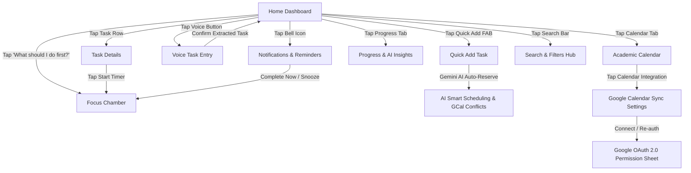

# TaskMind — Student Productivity App: Design System & Specifications

> **Source:** Stitch Project `TaskMind Student Productivity App` (Project ID: `8690940151860537302`)  
> **Target Platform:** Mobile First (Optimized for ~390px viewport, responsive to tablet/desktop)  
> **Status:** Final Stitch Design System Specification  

---

## 1. Brand Identity & Design Philosophy

TaskMind is a focused, intelligent, and approachable academic productivity companion for modern students. It balances academic rigor with tactile, frictionless, and motivating momentum.

### Core Philosophy & Emotional Goals
1. **Calm Mastery & Reduced Cognitive Load:** Minimizes friction and visual clutter during intense exam sprints and study routines.
2. **AI-First Clarity (Gemini Powered):** Proactively recommends what to tackle first, explains *why* based on urgency and course weightage, and auto-resolves scheduling conflicts without overwhelming the student.
3. **Tactile Satisfaction:** Celebrates student momentum through micro-animations, streak flame badges, animated checkboxes, and reassuring copy.
4. **Structured Mobile Layouts:** Single-thumb ergonomics, safe area inset handling, clean card elevations, and frictionless interactions.

---

## 2. Color Palette & Semantic Tokens

The color system uses high-clarity focal tones contrasted against soft ambient surfaces to reduce eye fatigue during late-night study sessions.

### Core Palette Tokens

| Semantic Token | Hex Code | Purpose & Usage |
| :--- | :--- | :--- |
| **`primary`** | `#3525CD` / `#4F46E5` | Primary brand tone, focused buttons, active states, key emphasis |
| **`primary-container`** | `#4F46E5` | Deep Indigo solid fill for primary CTAs, active badges, FAB |
| **`on-primary`** | `#FFFFFF` | Text/icons on top of primary buttons and containers |
| **`primary-fixed`** | `#E2DFFF` | Soft lavender highlight for AI suggestion cards, active tabs |
| **`on-primary-fixed`** | `#0F0069` | High-contrast deep navy text on primary-fixed surfaces |
| **`on-primary-fixed-variant`** | `#3323CC` | Subdued indigo text on primary-fixed surfaces |
| **`primary-fixed-dim`** | `#C3C0FF` | Inactive bar charts, muted primary states |
| **`secondary`** | `#6B38D4` / `#8B5CF6` | Soft purple for AI accents, creative tags, sprint milestones |
| **`secondary-container`** | `#8455EF` | Vibrant purple container for secondary buttons, live badges |
| **`secondary-fixed`** | `#E9DDFF` | Light lilac background for tags and collaborative chips |
| **`on-secondary-fixed`** | `#23005C` | Deep violet text for secondary pills |
| **`tertiary` / `success`** | `#005523` / `#22C55E` | Fresh emerald green for completed tasks, streaks, affirmative states |
| **`tertiary-container`** | `#007030` | Darker emerald container fill for checked states & success toasts |
| **`tertiary-fixed`** | `#6BFF8F` / `#4AE176` | Vibrant neon-green mint for success pills and badges |
| **`on-tertiary-fixed`** | `#002109` | High-contrast dark green text |
| **`error` / `critical`** | `#BA1A1A` / `#EF4444` | Crimson coral for urgent deadlines, overdue tags, destructive alerts |
| **`error-container`** | `#FFDAD6` | Soft coral background for urgent alerts and overdue ribbons |
| **`on-error-container`** | `#93000A` | Crimson text on error-container surfaces |
| **`warning`** | `#F59E0B` | Amber for impending deadlines (< 24h) and caution states |
| **`background` / `surface`** | `#F9F9FF` | Clean off-white canvas with subtle cool undertone |
| **`surface-container-lowest`**| `#FFFFFF` | Pure white for cards, elevated sheets, input fields |
| **`surface-container-low`** | `#F1F3FF` | Very light tint for nested card groups and form rows |
| **`surface-container`** | `#E9EDFF` | Neutral surface container for dividers, chips, inactive buttons |
| **`surface-container-high`**| `#E1E8FF` | Slightly elevated container for secondary controls |
| **`surface-container-highest`**| `#D9E2FC`| Highest surface contrast for inactive tracks and borders |
| **`on-surface`** | `#121B2E` / `#172033` | Dark navy for primary headings and body copy |
| **`on-surface-variant`** | `#464555` / `#667085` | Slate gray for secondary labels, metadata, captions |
| **`outline`** | `#777587` | Subtle border and placeholder color |
| **`outline-variant`** | `#C7C4D8` / `#E5E7EB` | 1px hairline stroke for cards and dividers |

---

## 3. Typography System

**Font Family:** `Inter`, sans-serif (Google Fonts)  
**Iconography Family:** `Material Symbols Outlined` (Google Fonts)

### Typography Scale Hierarchy

| Token | Size | Line Height | Weight | Letter Spacing | Standard Usage |
| :--- | :--- | :--- | :--- | :--- | :--- |
| **`headline-xl`** | 32px | 38px | 700 (Bold) | `-0.02em` | Focus Timer digits, large stat counters |
| **`headline-lg`** | 24px | 30px | 700 (Bold) | `-0.015em` | Main screen titles, greetings ("Hey, Alex 👋") |
| **`headline-md`** | 20px | 26px | 600 (SemiBold)| `-0.01em` | Section headers, card main titles |
| **`title-lg`** | 18px | 24px | 600 (SemiBold)| Normal | Top app bar title, major card headings |
| **`title-md`** | 16px | 22px | 600 (SemiBold)| Normal | Task titles, item row headings |
| **`body-lg`** | 16px | 24px | 400 (Regular) | Normal | Long descriptions, syllabus summaries |
| **`body-md`** | 14px | 20px | 400 (Regular) | Normal | Default body text, form descriptions |
| **`body-sm`** | 13px | 18px | 400 (Regular) | Normal | Metadata, timestamps, helper descriptions |
| **`label-lg`** | 14px | 18px | 600 (SemiBold)| Normal | Primary button labels, CTA text |
| **`label-md`** | 12px | 16px | 500 (Medium) | `+0.01em` | Chips, tags, secondary metadata |
| **`label-sm`** | 11px | 14px | 600 (SemiBold)| `+0.02em` | Subtitle badges, notification counters, tab labels |

---

## 4. Spacing, Elevation & Shape System

### Spacing Scale (8px Rhythm)
- `space-xs`: `0.25rem` (4px) — Internal icon gaps, micro badges
- `space-sm`: `0.5rem` (8px) — Spacing between card items, tag gaps
- `space-md` / `margin` / `gutter`: `1.0rem` (16px) — Screen outer padding, standard card padding
- `space-lg`: `1.5rem` (24px) — Spacing between major screen sections
- `space-xl`: `2.0rem` (32px) — Bottom action offsets, hero section gutters

### Border Radius
- `sm`: `0.25rem` (4px) — Tiny badges, sub-dividers
- `DEFAULT`: `0.5rem` (8px) — Inner buttons, nested chips, small widgets
- `md`: `0.75rem` (12px) — Form controls, inputs, secondary buttons
- `lg`: `1.0rem` (16px) — Standard cards, task containers, action sheets
- `xl`: `1.5rem` (24px) — Hero banners, modal sheets, focus chamber containers
- `full`: `9999px` — Pill tags, circular buttons, FAB, avatar frames

### Elevation & Shadows
- **Flat (Elevation 0):** `#F9F9FF` surface canvas, hairline stroke border `1px solid #E5E7EB`.
- **Card (Elevation 1):** `shadow-[0_1px_8px_rgba(23,32,51,0.04)]` or `shadow-sm` on pure white container.
- **Floating Sheet & FAB (Elevation 2):** `shadow-[0_6px_16px_rgba(23,32,51,0.18)]` with scale transforms on tap (`active:scale-95`).
- **Ambient AI Glow:** Background blurred discs (`bg-primary-fixed/40 blur-2xl`) positioned absolute behind hero cards.

---

## 5. UI Component Library

### 1. App Header (Fixed Top Bar)
- **Position:** `fixed top-0 inset-x-0 z-50 pt-safe bg-surface/85 backdrop-blur-xl`
- **Height:** 64px (16 units)
- **Elements:**
  - App Icon SVG (28x28px or 32x32px) with brand title "TaskMind" + subtitle indicating active screen
  - Notifications bell with live red counter badge (e.g., `2`)
  - User avatar with ring highlight (`ring-2 ring-primary-container/20`)

### 2. Bottom Navigation Bar
- **Position:** `fixed bottom-0 inset-x-0 z-50 pb-safe bg-surface-container-lowest/95 backdrop-blur-xl shadow-[0_-2px_12px_rgba(23,32,51,0.05)]`
- **5 Navigation Items:**
  1. **Home:** `home` icon + "Home"
  2. **Calendar:** `calendar_today` icon + "Calendar"
  3. **Quick Add (FAB):** Elevated central button (`w-12 h-12 -translate-y-3 rounded-full bg-primary-container text-on-primary shadow-lg`) with `add` icon
  4. **Focus:** `schedule` icon + "Focus"
  5. **Progress:** `bar_chart` icon + "Progress"

### 3. Buttons & Interactive Controls
- **Primary CTA:** Height 48px, rounded 12px (`rounded-xl`), background `#4F46E5`, text white `label-lg`, with active micro-scale `active:scale-[0.98]`.
- **Secondary Button:** Height 48px, rounded 12px, background `#F1F3FF` or pure white with `#E5E7EB` border.
- **Icon Button:** 40x40px or 44x44px rounded full, hover background `#E9EDFF`.
- **Segmented Toggles:** Rounded 12px container (`bg-surface-container-low`) with active tab elevated on pure white with `shadow-xs`.
- **Filter Chips:** Height 32px, pill rounded (`rounded-full`), active state `#4F46E5` with white text, inactive state `#E9EDFF` with `#121B2E` text.

### 4. Checkboxes & Task Completion
- Custom square checkbox: 22x22px with `rounded-[6px]`.
- **Unchecked:** Border 2px `#C7C4D8`, transparent background.
- **Checked:** Animated transition to solid `#007030` (`tertiary-container`) with white check icon and strikethrough text on task title.

### 5. AI Delight Badges
- **Gemini Sparkle:** Sparkle icon `auto_awesome` with soft purple or indigo tint and pill label `Gemini AI`.
- **Confidence Badge:** `98% AI Confidence` in mint pill.
- **Urgency Metric Score:** e.g., `Score: 96/100` with visual progress tracks.

---

## 6. Review of All 15 Screens & Components

### Screen 1: Home Dashboard (`fadd2d68222a4978af179f8e0f38885b`)
- **Header:** Hey Alex greeting + waving emoji + "5 Day Streak" flame badge.
- **Primary AI Hero Card ("What should I do first?"):**
  - Gemini AI badge, urgency score (`96/100`), task title (*DBMS Assignment — Normalization*), deadline countdown (*Due Tomorrow, 11:59 PM*).
  - Metadata strip: Est. 2h 30m, High Priority, AI Rationale pill.
  - Quick action: "Start Focus Session (45m)" primary button + "Mark Done" icon button.
- **Today's Progress Card:** SVG circular ring (60% / 3 of 5 tasks), focus hours logged (*1h 45m / 3h daily goal*).
- **Exam Countdown Banner:** Gradient card (*Mid-Term Exams in 12 Days*, *Data Mining Viva in 4 days*).
- **Upcoming Tasks List:** 4 task rows with interactive checkboxes, course tags, and priority labels.
- **AI Smart Suggestion Pill:** Free window suggestion between 3:00 PM – 5:00 PM.

### Screen 2: Quick Add Task (`490577651bc046af81573f631eeaa85c`)
- **Top Header:** Back arrow, "New Academic Task", Cancel and Save buttons.
- **Gemini Smart Suggestion Banner:** 94% Peak Match auto-schedule reservation (*Tomorrow, 3:30 PM – 5:30 PM*).
- **Form Controls:**
  - Task Title input with required indicator.
  - Description textarea for notes, rubrics, chapter notes.
  - Category selector chips (*Assignment, Exam Prep, Lab / Practical, Project, Revision, Reading*).
  - Due date & deadline selector with toggleable alarm reminder.
  - 4-segment priority selector (*Low, Medium, High, Urgent 🔥*).
  - Estimated effort slider with `-` / `+` 15-minute steppers.
  - Preferred study window picker (*Afternoon 2 PM – 6 PM vs. Night Owl 8 PM – 12 AM*).
  - Reminder alert & recurring schedule dropdowns.
  - File upload zone for PDF rubrics / assignment specs.
- **Sticky CTA:** "Create Task & Auto-Schedule".

### Screen 3: Task Details (`b9d03601aaa44257b0dff08555ad5f50`)
- **Action Bar:** Back button, status pills (*In Progress*, *Urgent*), edit and delete buttons.
- **Course & Title Header:** Course tag (*CS301 — DBMS*) + Full Assignment Title.
- **2x2 Key Specs Grid:**
  1. Deadline: Tomorrow 11:59 PM (18h left)
  2. Est. Effort: 2h 30m (45m logged)
  3. Weightage: 15% of Final Grade
  4. Course: CS301 (Prof. Vance)
- **AI Urgency Breakdown:** Score 96/100 with 3 horizontal metric bars (Deadline Proximity 98%, Course Impact 92%, Effort-to-Time Ratio 95%) + Gemini Reasoning tip.
- **Checklist Subtasks:** 4 checklist milestones with interactive check toggles and live progress counter.
- **Attached Materials Card:** `assignment_spec_v2.pdf` (1.4 MB) with download icon.
- **Sticky Actions:** "Start Focus Timer (45m)" + "Mark Complete".

### Screen 4: Academic Calendar (`5cbf48440c7849e4b915c90ebdb8e1e6`)
- **View Switcher:** Day / Week / Month tab selector.
- **Weekly Date Strip:** October 2024 (Week 8) horizontal scroll with 7 day pills (Mon 21 to Sun 27), highlighting today (Wed 23).
- **Filter Chips:** All Tasks, Assignments, Exams, Labs, Classes.
- **Urgent Milestones Ticker:** Pending upcoming deadlines list.
- **Daily Visual Timeline:** Vertical timeline with left-side timestamps:
  - 09:00 AM: CS301 DBMS Lecture (Lecture Hall B-204)
  - 11:00 AM: IoT Lab Session (IoT Wing C)
  - 12:30 PM: Free Study & Lunch Break indicator
  - 02:00 PM: AI Smart Focus Block (DBMS Assignment)
  - 05:00 PM: C Programming Practice (Coding Sprint)
  - 07:30 PM: Data Mining Viva Prep (Group Call)
- **Sync Status Card:** Google Calendar & Canvas LMS live status with "Sync Now" button.

### Screen 5: Focus Chamber / Pomodoro Mode (`383423ed66524c969be4ed138a00a8e3`)
- **Header:** Minimize button, "Focus Chamber", live pulsing dot, "2 of 4 pomodoros" badge.
- **Motivational Banner:** "You're doing good! 👏 Stay in the flow, Alex."
- **Current Task Card:** Active task with checkbox and course tag.
- **Preset Pills:** 25/5 Standard, 50/10 Deep Focus, Custom.
- **Hero Circular Countdown Ring:** SVG progress ring with animated stroke dashoffset, center digital clock `21:42`, session indicator (*Deep Work Session - Lap 2 of 4*).
- **Do Not Disturb Subtext:** "Phone silenced • Gemini smart blocks active".
- **Controls:** Big "Pause Session / Resume Focus" CTA, "Skip to Break", "Complete Task 🎉".
- **Ambient Focus Audio Soundscape:** Horizontal sound chips (*🎧 Lo-Fi Beats with animated ping, 🌧️ Soft Rain, ☕ Campus Cafe, 📚 Library Silence*).
- **Study Buddy Lounge:** "4 classmates focusing quietly right now".

### Screen 6: Shared Group Tasks (`fcac9654cac7492eb4495083b7c8d75f`)
- **Header:** Back button, "Group Projects", 2 active teams indicator, "+ New Group" button.
- **Active Project Bento Card:**
  - Team Alpha (CS 302 — Web Development Event Portal).
  - Sprint Progress: 65% complete (11 of 17 tasks done).
  - Collaborators list: Alex (Lead), Priya K. (API Backend), Marcus T. (Mobile UI), Sarah L. (Database) + "+ Invite" button.
- **Team Deliverables Board:** Task cards with assigned teammate avatar tags, status badges (*Done, In Review, In Progress, To-Do*).
- **Live Team Pulse Feed:** Real-time activity log (e.g., *Priya completed Backend API spec*, *Marcus pushed PR #14*).
- **Sticky Action:** "+ Add Group Task & Assign".

### Screen 7: Progress & AI Insights (`a1be08ec57ca4e398fb8aad0e96f834b`)
- **Header:** Week selector dropdown (*This Week: Oct 21 - 27*) + Share button.
- **Streak Hero Banner:** Gradient card (*5 Day Streak*, Active, unlock Weekend Shield reminder).
- **4-Card Summary Stats Grid:**
  - Completed: 18 (+4 vs last week)
  - Pending: 5 (On schedule)
  - Overdue: 1 (Needs urgent review)
  - Study Time: 24h 15m (avg 3.5h/day)
- **88% Completion Gauge:** Circular progress ring with peer comparison (*Outpacing 92% of peers*).
- **Weekly Study Hours Bar Chart:** Accessible 7-day bar chart with Wednesday peak indicator (5.2h).
- **Gemini AI Insights Cards:**
  1. Evening Peak Flow (68% tasks completed between 7 PM - 11 PM)
  2. DBMS Deadline Nearing (Reserve 4:00 PM slot)
  3. Heavy Load Tomorrow (Option to defer C programming to Friday)
- **Primary Action:** "Generate Optimized Plan for Tomorrow ⚡".

### Screen 8: Voice Task Entry (`7dbc4d549fed45a58f5dd5914e5170ce`)
- **Modal Header:** "Voice Task Entry" + Natural Speech Engine.
- **Interactive Mic Hero:** Gradient microphone button with pulsating wave rings and dynamic multi-bar waveform visualizer.
- **Live Transcription Card:** Real-time speech transcript (*"Remind me to finish DBMS normalization assignment tomorrow..."*).
- **Gemini AI Real-Time Parsing (98% Confidence):**
  - Extracted Task Title: *DBMS Normalization Assignment*
  - Course Match: *CS301* (Syllabus inferred)
  - Priority: *Urgent 🔥* (Auto-flagged)
  - Deadline: *Tomorrow, Oct 24, 10:00 PM*
  - Smart Reminder: *30 mins before (9:30 PM)*
- **Action Buttons:** "Confirm & Create Task" + "Edit Fields".

### Screen 9: Notifications & Reminders (`f80d4aea2e01492aa40637d7dcc04e83`)
- **Filter Tabs:** All (4), Urgent Reminders (2), Group Activity (2).
- **"Don't Let Me Forget" Sticky Card:** Pinned urgent reminder for DBMS assignment with countdown (*18h left*), progress bar (62% done), "Complete Now" button, and Snooze dropdown menu (*10 min, 30 min, 1 hour, Later this evening, Custom*).
- **Notification Feed:**
  - Urgent Due Date card with red edge-ribbon (*IoT Practical* + Quick Snooze).
  - AI Insight card with indigo edge-ribbon (*Gemini 2h free window plan* + Accept Slot / Modify).
  - Group Activity card with purple edge-ribbon (*Marcus completed task*).
  - Streak Motivation card with emerald edge-ribbon (*5-day streak maintained*).
- **Empty State Delight:** "All caught up here! 🎉" with celebratory illustration.
- **Bottom Settings Link:** "Reminder Preferences & Push Settings ⚙️".

### Screen 10: Search & Filters Hub (`414e6c62c8714f8592f8138984211f0a`)
- **Search Header:** Text input with instant clear `✕` button and filter trigger button.
- **Filter Pills Carousel:** All, Today, Upcoming, Completed, Overdue, Assignments, Exams, Study, Personal.
- **Encouraging Toast Banner:** "Only 2 tasks left today. You got this! 👏".
- **Search Results Feed:**
  - Overdue Task Card with top crimson banner ribbon and reschedule / mark done actions.
  - High Priority Task Card with expandable "Why this task? (AI Explanation)" accordion.
- **UI States Lab:** Live Success microcopy banner (+50 XP, Undo action) + Empty search state illustration + Daily Velocity progress gauge.

### Screen 11: AI Smart Scheduling & GCal Conflicts (`ebfdb9c9f5c94f8d80260c9acad43e28`)
- **Status Capsule:** Google Calendar Synced + Gemini 1.5 Active.
- **Task Focus Summary:** DBMS Assignment target specifications.
- **Real-Time Conflict Alert Card:** Red card highlighting conflict (*Busy: 5:00 PM – 7:00 PM — CS301 Database Systems Lab imported from GCal*).
- **Hero Gemini Recommendation Card:** Optimal Slot (*7:30 PM – 9:30 PM Tonight, 98% Flow Match*) with 3 rationale bullet points (Zero calendar friction, Peak focus window, Well-spaced buffer) + "Reserve & Sync to Google Calendar" CTA.
- **Visual Day Timeline:** Vertical stack showing 3:00 PM Free, 5:00 PM Busy Conflict, 7:00 PM Dinner/Transit Buffer, 7:30 PM AI Selected Block, 9:30 PM Open Leisure.
- **Auto-reschedule Toggle Switch** and Custom Time Picker button.

### Screen 12: Google OAuth 2.0 Permission (`dff6c0cf715741cc90ca7d2865ab1069`)
- **Trust Banner:** Google Cloud Verified OAuth 2.0 Client.
- **Integration Hero:** TaskMind logo connected via animated sync arrows to Google Calendar brand mark.
- **Active User Account Card:** Alex Chen (`alex.chen.cs@university.edu`) with account switcher.
- **3 Requested Permissions List:**
  1. *See your calendar events* (Read-only) — Scanning lecture hours.
  2. *Add & edit TaskMind events* (Write) — Auto-adding focus sessions.
  3. *Offline access & real-time sync* (Background) — Keeping timetable current.
- **Student Data Privacy Guarantee Box:** End-to-end encryption assurance.
- **Interactive Sync Diagnostics Simulator:** Status pill with Ready, Syncing, Synced, Failed preview buttons.
- **Actions:** "Allow & Connect Calendar" Google CTA + "Cancel".

### Screen 13: Google Calendar Sync & Settings (`5e4c7e2f06034bcd828cc3751fa0056e`)
- **Connection Header:** Connected account card with live Sync Now button.
- **Master Switch:** Two-Way Auto Sync real-time toggle.
- **Select Calendars List:** Checkboxes for *University Lectures & Labs*, *Personal & Study*, *Exams & Milestones*, *Campus Clubs & Events*.
- **Student Smart Rules:**
  - Rule 1: Export Study Sessions to GCal as "Busy".
  - Rule 2: Import Campus Lectures as Busy Windows.
  - Rule 3: Push Assignment Deadlines as All-Day Events.
- **Sync Health & Activity Stats:** Incoming (14 lectures imported) vs Outgoing (3 tasks & study blocks).
- **Disconnect Flow:** "Disconnect Google Calendar" button with confirmation modal sheet.

### Screen 14: TaskMind App Icon Asset (`c1511f035bd34436a65c7a00c9546026`)
- **SVG Specification:**
  - Dimensions: 100x100 (viewBox `0 0 100 100`)
  - Background: Solid `#4F46E5` rectangle with `rx="24"`
  - Book Body: White silhouette open book with curved pages and soft `#8B5CF6` spine
  - Sparkle: 8-point gold AI spark star (`#FACC15`) floating above the central spine.

### Screen 15: Avatar & Media Assets (`e2fee712933e481b89862185c4979df9`)
- **Profile Avatar:** High quality smiling student with glasses, hoodie, warm campus lighting.
- **Campus Study Illustrations:** Study desk setups with warm ambient lighting, student collaboration photos.

---

## 7. UI/UX Interaction Flows & State Transitions

### Key Interactive Patterns
1. **Gemini Task Prioritization:** Calculates urgency based on `(Deadline Proximity × 0.5) + (Grade Weightage × 0.3) + (Effort Ratio × 0.2)` and presents high-conviction recommendations with transparent reasoning.
2. **Conflict Resolution Engine:** Checks Google Calendar busy periods before placing study blocks, displaying visual warning bars when events collide with in-person lectures.
3. **Pomodoro Focus Chamber:** Features a countdown timer with smooth SVG dashoffset animations, customizable intervals, and ambient soundscapes (Lo-Fi, Rain, Cafe, Library).
4. **Interactive Checkbox Feedback:** Checking tasks triggers micro-scale animations, green fill transitions, and positive motivational streak toasts (+50 XP).
5. **Smart Snooze Mechanism:** Offers tailored contextual snooze intervals (*10 min quick rest, 30 min power nap, 1 hour lunch break, 7 PM evening study block*).

---

## 8. Implementation Guidelines for Development

1. **Mobile-First Responsiveness:**
   - Keep horizontal padding `px-4` (`16px`) on mobile viewports.
   - For tablet/desktop viewports, center the main container within a max width of `480px` (or expand to a multi-column dashboard on `md:` breakpoints).
2. **Safe Area Insets:**
   - Always include `.pt-safe` on fixed headers and `.pb-safe` on fixed navigation bars to accommodate device notches and gesture bars.
3. **Asset & Icon Management:**
   - Use Google Material Symbols Outlined font with optical size `20..48` and variable `FILL` support.
   - Use the embedded SVG App Icon for headers and favicon.
4. **Micro-Interactions & Performance:**
   - Use hardware-accelerated CSS transitions (`transform`, `opacity`) with cubic-bezier easing (`active:scale-95`).
   - Keep timer tickers and waveform visualizers lightweight without memory leaks.
